# MapleStory Classic World on the AYN Thor

Here's how I play MapleStory Classic World on my Thor through the official
Nexon Launcher in GameNative. Run the helper on your computer, then follow the
steps on the Thor.

The Windows helper downloads the files, checks them, installs GameNative and
copies the installer, runtime and controller layout onto the Thor. Then you
follow the steps below to enter the settings and sign into Nexon. You don't
need to write commands.

## Contents

- [Before you start](#before-you-start)
- [1. Download this setup on your computer](#1-download-this-setup-on-your-computer)
- [2. Let your computer talk to the Thor](#2-let-your-computer-talk-to-the-thor)
- [3. Run the helper](#3-run-the-helper)
- [4. Open GameNative and add the runtime](#4-open-gamenative-and-add-the-runtime)
- [5. Add the Nexon installer to the library](#5-add-the-nexon-installer-to-the-library)
- [6. Enter the installer settings](#6-enter-the-installer-settings)
- [7. Install Nexon Launcher](#7-install-nexon-launcher)
- [8. Switch the same entry to the installed launcher](#8-switch-the-same-entry-to-the-installed-launcher)
- [9. Apply the graphics fix](#9-apply-the-graphics-fix)
- [10. Turn on touch and sign in](#10-turn-on-touch-and-sign-in)
- [11. Download Classic World](#11-download-classic-world)
- [12. Set up the controller](#12-set-up-the-controller)
- [Change controller buttons](docs/controller-setup.md#change-controller-buttons)
- [Next time you play](#next-time-you-play)
- [If something gets stuck](#if-something-gets-stuck)
- [Files and sources](#files-and-sources)

## Before you start

You'll need:

- An AYN Thor with Wi-Fi and several GB of free space. The game download is
  about 2 GB. GameNative and its runtime need more room.
- A Windows 10 or 11 computer with internet.
- A USB cable that carries data. Some cables only charge.
- Your own Nexon account and access to its verification emails.

The helper downloads about 700 MB onto your computer. The game downloads later,
inside Nexon Launcher on the Thor. No Python, Android Studio or root needed.

If GameNative 1.3.0 is already installed, the helper keeps it and its data.
For another version, it stops so you can decide what to do with it.
Keep your existing GameNative installation and other games. Uninstalling
GameNative removes the Windows environments and saved settings for every game
in the app. This setup adds a single custom game to your existing library.

Using a Mac, Linux or just the Thor? Follow [manual file preparation](docs/manual-setup.md),
then join this guide at step 4.

## 1. Download this setup on your computer

1. [Download the setup ZIP](https://github.com/ROM-HackZ/maplestory-ayn-thor/archive/refs/heads/main.zip).
2. Open your computer's Downloads folder.
3. Right-click the ZIP and choose **Extract All**, then **Extract**.
4. Open the extracted folder. Keep opening it until you can see
   `Start-Setup.cmd` and `README.md` together.

Leave this guide open while you work. Run the helper from the extracted folder,
not from inside the ZIP.

## 2. Let your computer talk to the Thor

1. On the Thor, open Android's **Settings**.
2. Scroll to the bottom and open **About handheld console**. Scroll down to
   **Build number**. On other firmware, this page may be called **About device**.
3. Tap **Build number seven times**. Enter the Thor's screen-lock PIN if asked.
   You should see a message saying developer options are enabled.
4. Return to Settings. Open **System**, then **Developer options**. If it isn't
   there, search Settings for `Developer options`.
5. Turn on **USB debugging** and accept its confirmation.
6. Connect the Thor to the computer with your USB data cable. Unlock the Thor.
   If it asks what to use USB for, choose **File transfer**.
7. Unplug other Android phones or handhelds from this computer for now.

Watch the Thor for an **Allow USB debugging?** message. It may appear when the
helper starts. Tap **Allow**. This permission lets the helper install the app
and copy the files.

Find the Android settings and USB debugging switch

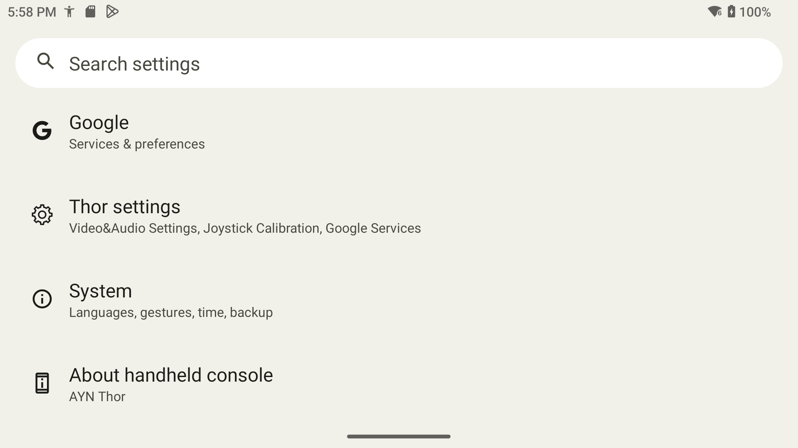

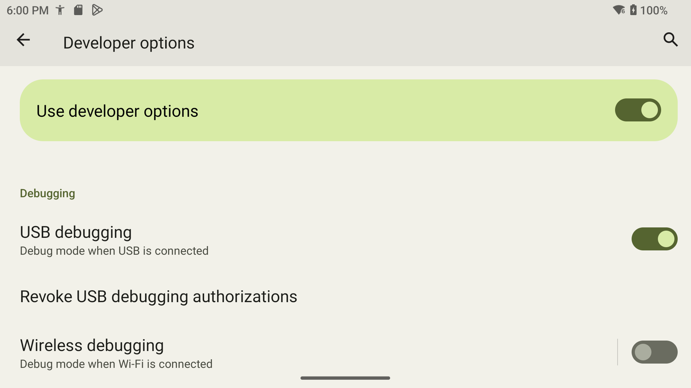

## 3. Run the helper

1. On your computer, double-click **Start-Setup.cmd**. Windows may hide `.cmd`,
   so it may appear as **Start-Setup**.
2. Keep the window open. It downloads and checks GameNative, the Nexon installer,
   Proton and Google's USB tools. The GameNative download is the largest.
3. If the Thor shows **Allow USB debugging?**, tap **Allow**.
4. If the helper stops because permission wasn't allowed yet, run it again.
   It reuses downloads that pass their checks.
5. Wait until it says **Files ready on the Thor. Continue with step 4 in README.md.**

At that point you should have:

| On the Thor | What it is |
|---|---|
| GameNative in the app list | The Android app that runs the launcher |
| `Download/NexonLauncher/NexonLauncherSetup.exe` | The Windows installer you'll run inside GameNative |
| `Download/ThorSetup/proton-11.0-2-arm64ec.wcp` | The runtime you'll import in the next step |
| `Download/ThorSetup/MapleStory-Thor.icp` | The optional controller layout |

You can unplug the USB cable now. Keep the Thor connected to Wi-Fi.

If the helper stops, leave its message open and check [troubleshooting](#if-something-gets-stuck).
Don't run the Nexon `.exe` on your computer. It belongs on the Thor for this setup.

## 4. Open GameNative and add the runtime

A runtime is the software GameNative uses to run Windows programs. This setup
uses one for installing Nexon Launcher and another for running it afterward.

1. On the Thor, open **GameNative** from the Android app list.
2. On the Steam sign-in screen, tap **Skip login** at the bottom. Leave the Steam
   fields empty. Let any required files finish downloading and allow storage
   access if requested.
3. In the library, tap the **three horizontal bars at the top right** to open
   **System**, then tap **Settings**. Under **Emulation**, scroll down to
   **Wine/Proton Manager** and tap it.
4. Look at the installed versions. If **Proton 11.0-2 ARM64EC**, version code **1**,
   is already installed, keep it and skip to item 8.
5. Scroll down inside the manager to **Import from local storage**, then tap
   **Import .wcp Package**.
6. In the Android file picker, open the Thor's internal storage, then
   **Download**, then **ThorSetup**. Select **proton-11.0-2-arm64ec.wcp**.
7. Selecting the `.wcp` starts installation automatically. Wait, then scroll
   down inside the manager. Look for **installed successfully** and an entry
   named **Proton: proton-11.0-2-arm64ec** under **Installed Wine/Proton Versions**.
8. Close the manager and return to the library. The installer uses GameNative's
   bundled **Proton 9.0 x86_64** option. You'll select it in step 6. If GameNative
   asks to download required files, let that finish. Don't substitute Proton 11
   for the installer step.

You should now have both runtimes available. The final Proton component ID is
`proton-11.0-2-arm64ec-1`. Avoid similarly named packages ending in `-6`.

Find the runtime import button and check the finished import

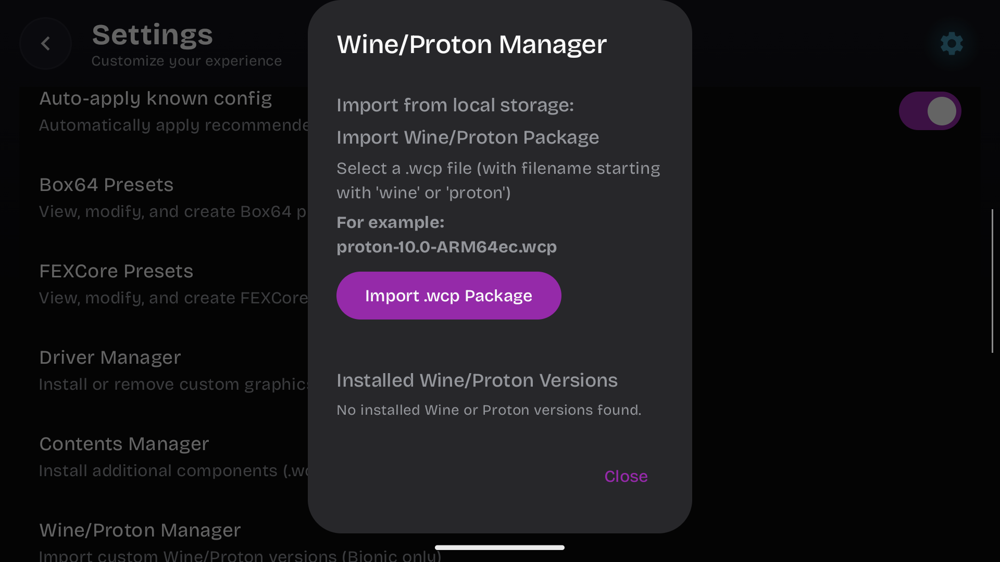

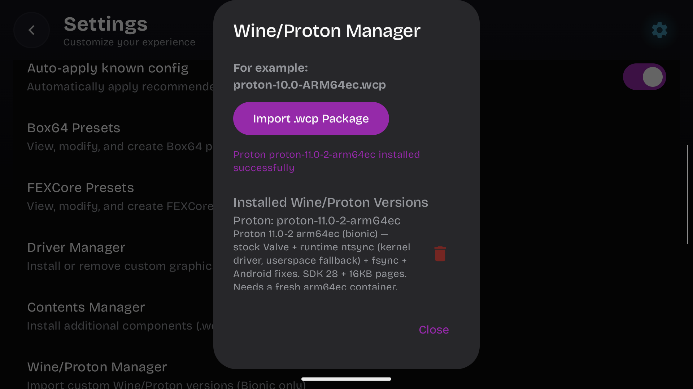

## 5. Add the Nexon installer to the library

1. In GameNative's library, tap **Add Game** or the **+** control for adding a
   custom game. Choose **Add Custom Game** if a choice appears.
2. Read the folder prompt and tap **OK**.
3. In the folder picker, open internal storage, then **Download**, then
   **NexonLauncher**. Select this folder with **Use this folder** and allow access
   if asked. Select the folder, not the `.exe` file inside it.
   If Android says **Can't use this folder** while you're in Download, scroll
   down and open **NexonLauncher**. The restriction is on the parent Download
   folder, not that subfolder.
4. If an import prompt offers **Remove original after import**, leave that
   unchecked so the source folder stays on the Thor.
5. The entry should appear as **NexonLauncher**. Use that name if asked to name it.
6. Tap the entry, then tap the **gear beside Play**. In the Options panel,
   choose **Edit container**.

In these settings, GameNative may call the Windows environment a **container**.
Keep using this same entry and container throughout the guide.

Choose the installer folder and open its settings

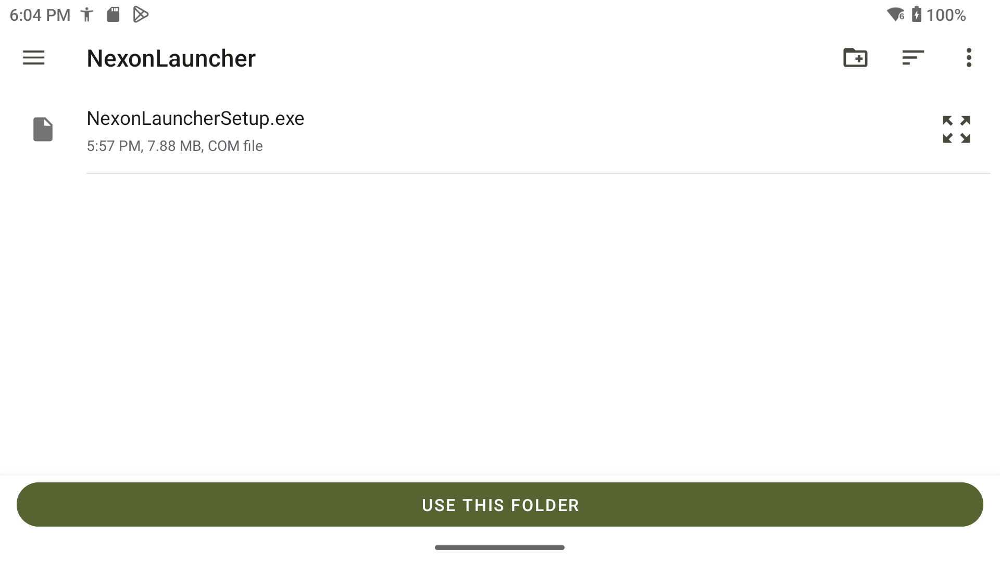

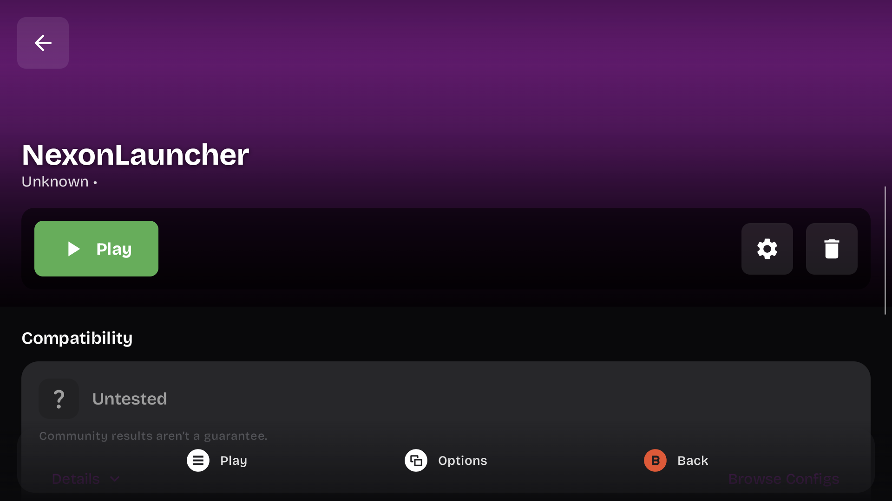

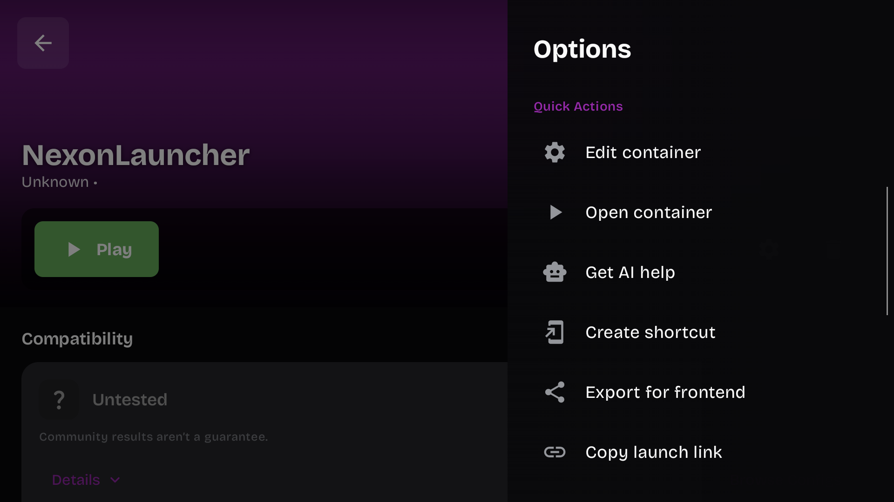

## 6. Enter the installer settings

Open each named setting and choose the value below. Some fields are on other
tabs or farther down the settings page.

1. On the **General** tab, check **Container Variant** is **bionic**.
2. Open **Wine Version** and choose **proton-9.0-x86_64**, even if another
   version is already selected.
3. On **General**, open **Executable Path** and choose **NexonLauncherSetup.exe**.
4. Open the **Graphics** tab. Set **Graphics Driver** to **Wrapper** and
   **Graphics Driver Version** to **System**.
5. On **Graphics**, set **Display Renderer** to **GL** and **DX Wrapper** to **DXVK**.
6. Leave **Screen Size** at **1280x720** for the installer and leave the DXVK
   subversion at its default. You'll change Screen Size for the game in step 8.
7. Return to **General** and check the executable still says **NexonLauncherSetup.exe**.
8. Tap the **disk-shaped Save icon on the main settings window**.
9. Open **Edit container** again. Check that the runtime still says
   **proton-9.0-x86_64** and the graphics settings match items 4 and 5.

The small **OK** button inside a popup only closes that popup. You still need
that outer Save icon to save the container. Close settings after checking.

Check the installer settings against these pictures

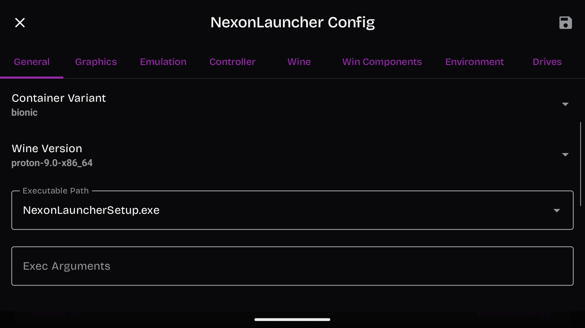

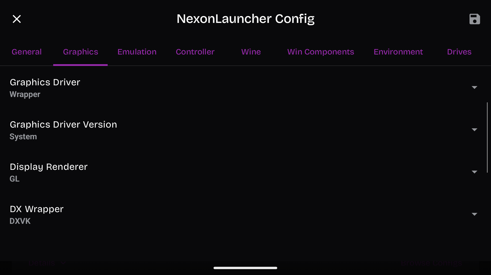

## 7. Install Nexon Launcher

1. On the NexonLauncher entry, tap **Play**. On a fresh setup, GameNative first
   downloads **proton-9.0-x86_64** and prepares its Windows files. Keep it open
   and wait for this to finish. The Nexon setup window should then open.
2. Before clicking through setup, press **Android Back** to open **Quick Menu**.
   Tap **Controller** (the D-pad icon), then scroll down in that panel. Turn
   **Touchscreen Mode ON** and **Shooter Mode OFF**. An enabled mode has a purple
   ring around its icon. Close the menu with **X**, then tap the center **Play**
   button if the screen is paused.
3. Choose your language, tap **OK**, then **Next**. Stop at **Choose Install Location**.
4. Press **Android Back**, then choose **Controller → Keyboard** in Quick Menu.
   The full-width keyboard covers the destination field. Tap the **four-square
   menu** at the keyboard's upper left and choose **Floating**. Drag the handle
   along the bottom of the floating keyboard to the right, until you can see
   the destination field beside it.
5. Tap the destination field. Replace its contents with exactly **`D:\Launcher`**.
   If the old path isn't highlighted, hold the keyboard's **Backspace** until
   the field is empty. Use **?123** for the colon, then the second symbols page
   (**=\<**) for the backslash **`\`**. Tap **ABC** to return to letters.
   Check the whole path while the keyboard is still open.
6. Tap Android's **down arrow at the bottom-left edge of the screen** to hide
   the keyboard. Check that the destination still says **`D:\Launcher`**, then
   tap **Install** and wait for it to finish.
7. On the last screen, untick **Run Nexon Launcher** and **Run Nexon Launcher
   when my computer starts**. Then tap **Finish**.

In this setup, `D:` points to Android's `Download` folder. Open the Thor's file
manager, then **Download → Launcher**. Check that **nexon_launcher.exe** is there
before continuing. If it's missing, check the container's drive mapping before
going further.

The keyboard steps above use Gboard. If your keyboard looks
different, use its floating or resize control so you can see the field while
typing. Keep it floating for the launcher sign-in too.

Check the touch modes and floating keyboard

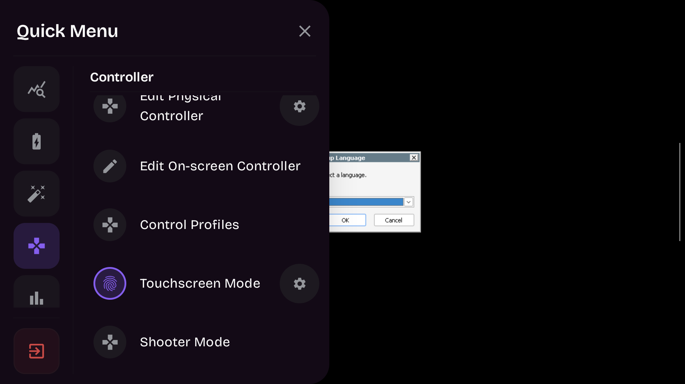

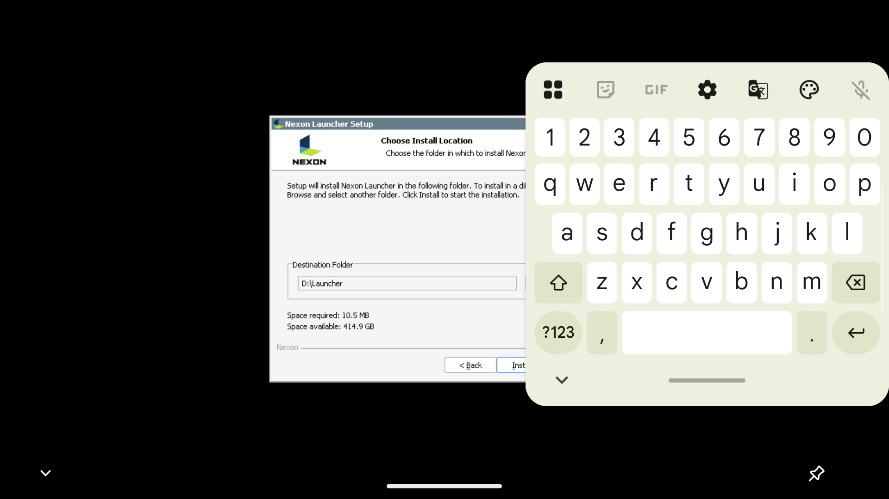

## 8. Switch the same entry to the installed launcher

1. Return to the **same NexonLauncher entry** in GameNative. Open its options
   menu, then **Edit container**.
2. On **General**, open **Executable Path** and choose **Custom path**. Tap the
   text field. If the floating keyboard overlaps this dialog, drag its bottom
   handle to the bottom of the screen to dock it. This GameNative dialog moves
   above the docked keyboard, so the path stays visible.
3. Hold the old filename until it's highlighted, then replace it with exactly
   **`D:/Launcher/nexon_launcher.exe`**. This path uses forward slashes. It points
   to the program installed in step 7.
4. Tap the popup's **OK**, then tap the **outer disk Save icon**. If the keyboard
   is still open, hide it with Android's bottom-left down arrow.
   Don't press Back again after it closes. That opens
   a prompt to discard the changes. Choose **Cancel** if that prompt appears.
5. Reopen settings. Check that the path is still there.
6. On **General**, change **Wine Version** to **Proton 11.0-2 ARM64EC**, component
   **`proton-11.0-2-arm64ec-1`**.
7. Check the remaining settings against this table. **Screen Size** is farther
   down the General tab. Open its list and scroll inside the list to find
   **1366x768**. You'll set the game's graphics in step 9.

| Setting | Choose or enter |
|---|---|
| Container variant | bionic |
| Emulation tab: FEXCore Version / 64-bit Emulator | 2605 / FEXCore |
| Emulation tab: 32-bit Emulator / Box64 Version | Box64 / 0.4.2 |
| General tab: Screen Size | 1366x768 (16:9) |
| Extra launch arguments | Leave the field empty |
| Environment tab | Leave its defaults |

8. Tap the **outer disk Save icon** again.
9. Reopen settings and check the **Proton 11.0-2 ARM64EC** selection,
   **`D:/Launcher/nexon_launcher.exe`** and **Screen Size 1366x768**. Then close
   settings and continue to step 9 before tapping Play.

Use **1366x768** so your taps line up with the game's buttons.

Keep this container. Creating a second one would leave the launcher's installed
Windows files and registration behind.

Enter the launcher path, then check the saved settings

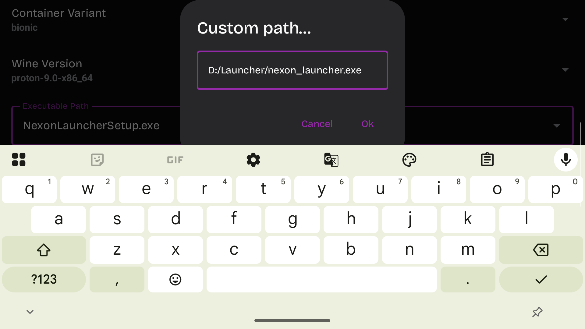

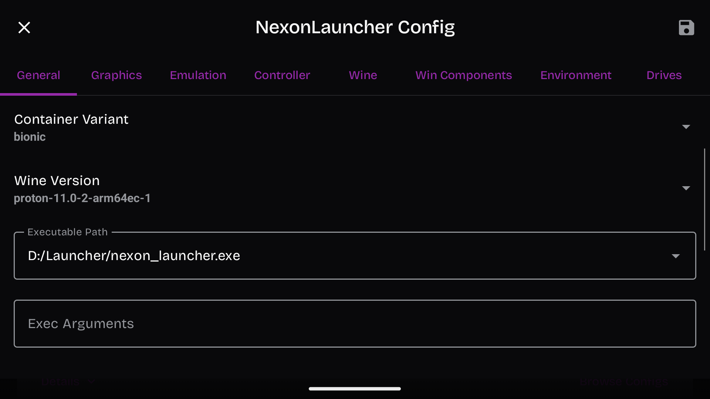

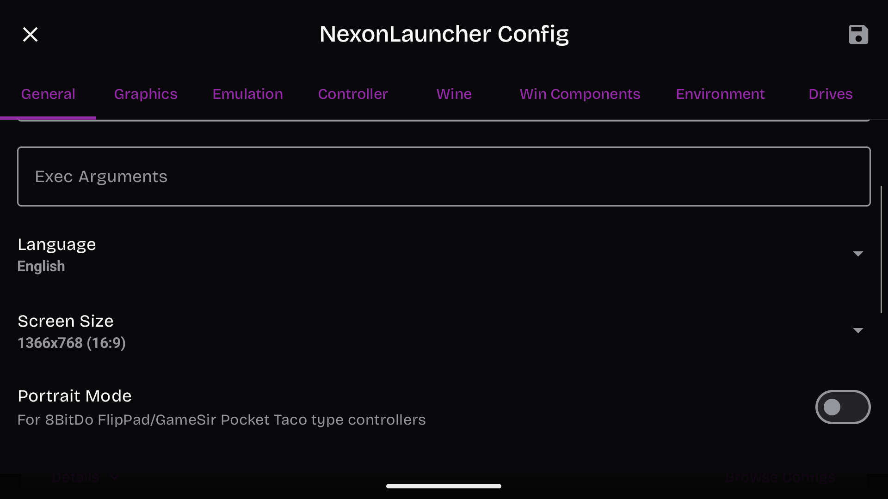

## 9. Apply the graphics fix

Do this before launching the game. Switch from the installer's **System** driver
to **Turnip** to fix flashing clouds and broken scenery.

1. On the **same NexonLauncher entry**, open its options, then **Edit container**.
2. Open the **Graphics** tab and set these values:

| Setting | Choose |
|---|---|
| Graphics Driver | Wrapper |
| Graphics Driver Version | turnip25.3.0_R3_Auto |
| Display Renderer | GL |
| DX Wrapper | DXVK |
| DXVK subversion | Leave the default |

3. Tap the **outer disk Save icon** on the main settings window.
4. Reopen **Edit container → Graphics**. Check that the exact Turnip version,
   **GL** and **DXVK** are still selected, then close settings.
5. Tap **Play**. The first launch after changing runtimes prepares the Proton 11
   base. Wait for that to finish, then let Nexon Launcher download its own updates.

Keep **Display Renderer** on **GL** when using these settings.

Check the graphics choices against this picture

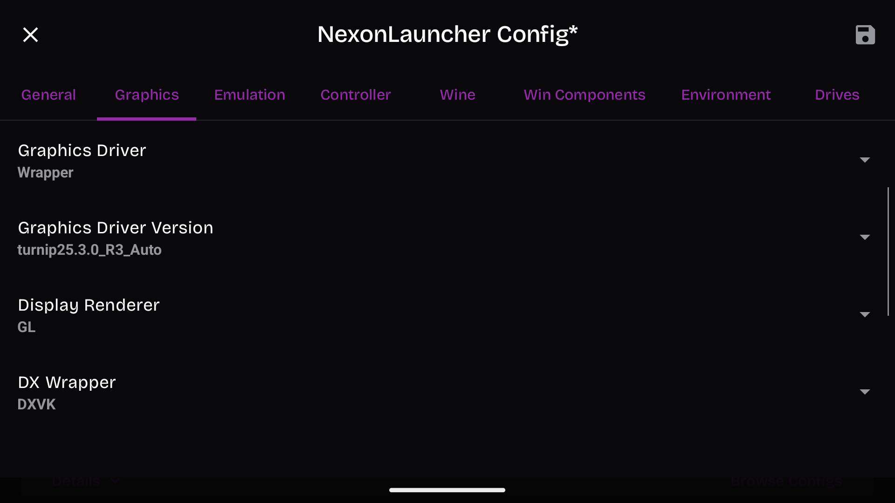

## 10. Turn on touch and sign in

Let the launcher's first update finish. If it leaves a black screen, press
**Android Back**, tap the **red exit icon at the bottom left**, then open the
same **NexonLauncher** entry and tap **Play** again.

1. While Nexon Launcher is running, press **Android Back** to open GameNative's
   **Quick Menu**.
2. Open **Controller** and scroll down in its panel.
3. Check **Touchscreen Mode is ON** and **Shooter Mode is OFF**, as set in step 7.
4. Close the menu. If the screen is paused, tap the center **Play/resume** control.
5. Tap the Nexon sign-in field. To open the keyboard, press **Android Back**,
   choose **Controller → Keyboard**, and tap the field again. If it's docked,
   use its **four-square menu → Floating** again. Move it to the right so the
   sign-in field stays visible on the left.
6. Sign into your own Nexon account and complete its email verification.
7. Wait for any **What's New** popup to load, then tap **Close** at its bottom
   right. This popup sits over the launcher and can block clicks behind it.
8. Tap the **square maximize button on Nexon Launcher's title bar**, beside
   the **X** at the top right. Keep the launcher maximized to avoid duplicated
   window edges.

If a blank panel appears after login, use the restart steps under
[a frozen or corrupted launcher](#the-launcher-freezes-or-shows-corrupted-graphics).

Keep the sign-in field visible beside the keyboard

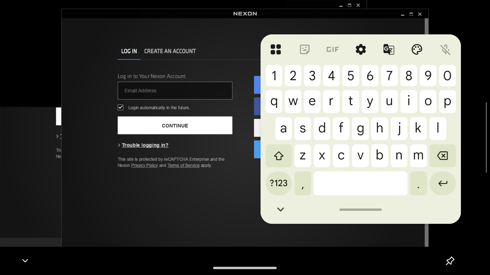

## 11. Download Classic World

1. In Nexon Launcher, choose **MapleStory**.
2. Choose **Classic World**.
3. Tap **Download**. Some launcher screens show **Play Now** first.
   In the download dialog, leave **Game installation location** at its default,
   **`C:\Nexon\Library\maplestorycw`**. It should show about **2 GB** required.
   Tap the blue **Download** button at the bottom right.
4. Wait for the button to change to **Play**. If the progress screen freezes,
   including at **85%**, use the
   [restart steps below](#the-launcher-freezes-or-shows-corrupted-graphics),
   close **What's New**, and check for **Play** before starting another download.
5. Tap **Play** and wait through the startup logos. Leave the game on its
   **Log In** screen while you import the controller layout below. This keeps
   the controller menus from pausing an active server connection during setup.

## 12. Set up the controller

1. Follow [Import the layout](docs/controller-setup.md#import-the-layout) to load
   the Thor controls in GameNative.
2. Back in the game, tap **Log In**. Tap your world, then tap a channel. Check
   that the red circle marks the channel you tapped. Tap **Go to the selected
   world** above the channel list.
3. On **Select a Character**, create a character if you need one, or tap your
   existing character and then **Select a character** to enter the game.
4. Try the left stick or D-pad to move, **A** to jump and **X** to attack.
5. To move an action to another button, follow
   [Change controller buttons](docs/controller-setup.md#change-controller-buttons).

GameNative sends keyboard presses for the Thor's buttons. That's why MapleStory's
**Controller** tab doesn't match this layout. Make button changes in GameNative's
**Edit Physical Controller** screen.

Check the selected channel

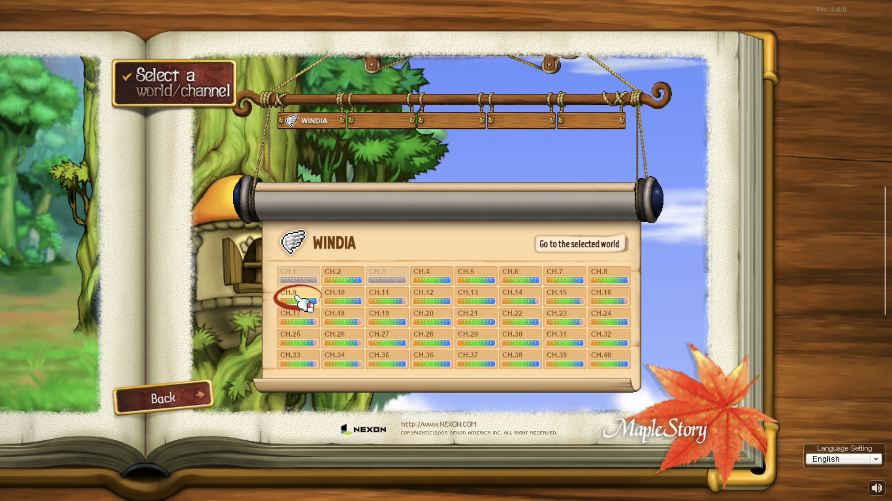

## Next time you play

1. Open **GameNative**, choose **NexonLauncher**, and tap **Play**.
2. Sign into Nexon if asked. Close **What's New** if it appears and maximize
   the launcher window.
3. Choose **MapleStory → Classic World → Play**.
4. In the game, tap **Log In**, choose your world and channel, then select
   your character.

Keep **Download/Launcher**. Those are the installed launcher files. Also keep
**Download/NexonLauncher**, its original installer, `.gamenative` marker and
icon. GameNative's library discovery may depend on that source folder. Keep
the same container too, since it holds the installation and login state.

## If something gets stuck

### The helper can't find the Thor

Unlock the Thor and check that USB debugging is on. Unplug and reconnect the
cable, then look for **Allow USB debugging?** on the Thor. Try another data cable
or USB port. Unplug other Android devices and run **Start-Setup** again.
If Windows still can't see the Thor, check Windows Update for its USB driver,
or use [manual file preparation](docs/manual-setup.md).

### Download check failed

Run the helper again after checking your internet connection. It downloads a
new copy of any cached file that fails its check. If the error keeps happening,
the upstream download may have changed. Stop there and
[report the component name and error](https://github.com/ROM-HackZ/maplestory-ayn-thor/issues).
Nexon's installer must still be version **2.4.0.0** with a valid **NEXON Korea
Corporation** signature for the helper to accept it.

### Different GameNative version

The helper keeps your installed app and stops. Don't uninstall it just to get
past this message. Uninstalling can remove your containers and their data.
This guide uses **1.3.0**, version code **24**. Use
[manual file preparation](docs/manual-setup.md) to copy the files yourself if
you want to keep another version. Its menus and settings may differ.

### A different file already exists on the Thor

The helper won't overwrite it. Use the Thor's file manager to move that file
somewhere safe, then run **Start-Setup** again. Keep any working launcher and
container. The helper only needs the three file destinations listed
in step 3.

### A setting or executable path won't stick

Tap **OK** in the small popup, then the **disk Save icon on the main settings
window**. Reopen the settings and check the value before launching.

### Touch doesn't work, or the screen looks paused

Repeat step 10, items 1 to 4. Touchscreen Mode should be on and Shooter Mode off.
Close the menu and tap the center Play control if paused.

### Nexon Launcher hangs after switching runtime

Stop and restart GameNative normally. Keep its data and the same container.
For a missing executable, check **Download/Launcher/nexon_launcher.exe** and the
`D:` drive mapping described in step 7.

### Taps land above or beside the game buttons

Exit through GameNative's Quick Menu, then open the same entry's **Edit
container → General**. Scroll down and set **Screen Size** to **1366x768 (16:9)**.
Tap the outer Save icon and launch again. Check that Touchscreen Mode is on
and Shooter Mode is off too.

### The launcher freezes or shows corrupted graphics

1. Press **Android Back** to open GameNative's **Quick Menu**.
2. Tap the **red exit icon at the bottom left**. Wait for the library to return.
3. Open the **same NexonLauncher entry** and tap **Play**.
4. Sign in again if asked, close **What's New**, and maximize the launcher.
5. Choose **MapleStory → Classic World** and check for **Play**. Keep your app
   data and the same container.

If that restart still leaves a black or frozen screen, exit through Quick Menu
again. On Android, open **Settings → Apps → See all apps → GameNative**. Tap
**Force stop → OK**, then **Open**. Choose **Skip login** if GameNative shows
its Steam sign-in screen, then launch the same NexonLauncher entry. Your
container and installed files stay in place.

If the launcher responds but the edges look duplicated or corrupted, first
close **What's New** and maximize the launcher as described in step 10.

### Clouds or pieces of the map flash or draw in the wrong place

Exit through GameNative's Quick Menu, then repeat
[step 9, Apply the graphics fix](#9-apply-the-graphics-fix).

### Nexon shows maintenance

Wait until the service opens and try again. Keep the working container settings.

## Files and sources

The helper downloads the components from the official sources below. You can
find the versions in [setup-manifest.json](setup-manifest.json) and file hashes
in [SHA256SUMS.txt](SHA256SUMS.txt).

- [GameNative](https://gamenative.app/) and [v1.3.0 release](https://github.com/utkarshdalal/GameNative/releases/tag/v1.3.0).
- [GameNative runtime component manifest](https://raw.githubusercontent.com/utkarshdalal/GameNative/f3f954f54b98d75b79feb7b8cdff41c7d4d935a7/manifest.json).
- [Nexon's official launcher download help](https://playersupport.nexon.com/hc/en-us/articles/204158099-Where-can-I-find-the-Nexon-Launcher).
- [Google's Platform Tools](https://developer.android.com/tools/releases/platform-tools) and [USB debugging instructions](https://developer.android.com/studio/debug/dev-options).

For command-line options, see [helper notes](docs/helper-notes.md).
