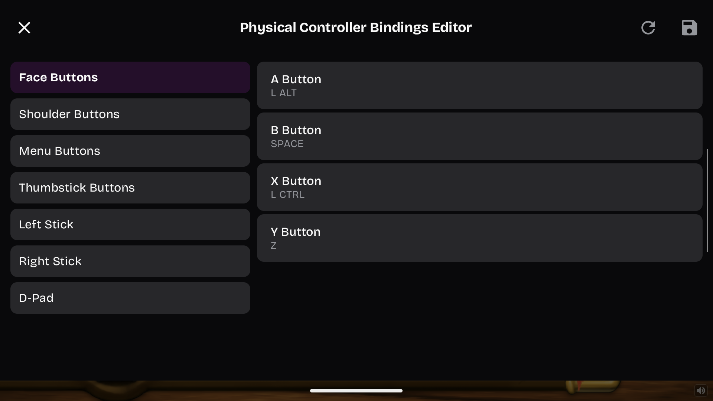
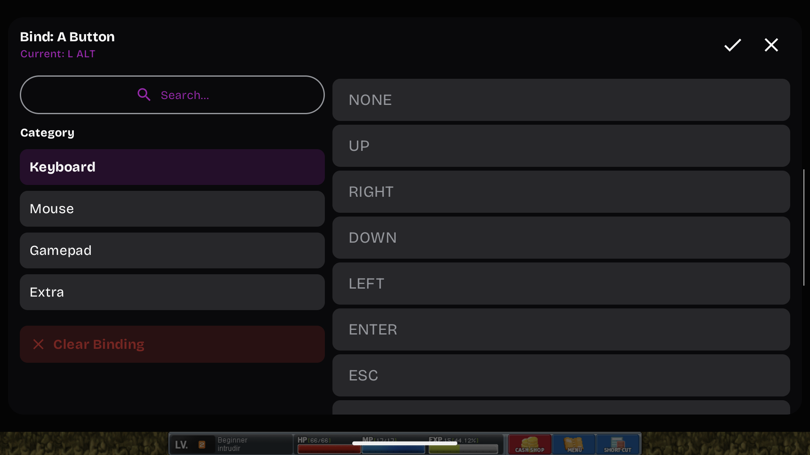

# Controller setup

This is my exported Classic World profile from the Thor. It's bundled as
**MapleStory-Thor.icp** in the setup ZIP. Import it in GameNative, then change
any buttons you want.

## Why the game's Controller menu doesn't match

GameNative turns each Thor button into a keyboard press before it reaches the
game. With this layout, pressing **A** sends **Left Alt**, which the game uses
for jump. Pressing **X** sends **Left Ctrl** for attack.

MapleStory's **Controller** tab shows its own gamepad controls, so that screen
doesn't describe this layout. Change which key a Thor button sends in
**GameNative's Edit Physical Controller** screen. To change what a keyboard
key does in MapleStory, use the game's **Keyboard/Mouse** tab and match that
key in GameNative too.

## Import the layout

1. On the Thor, check **Download/ThorSetup** for **MapleStory-Thor.icp**. The
   current setup helper copies it there alongside the runtime. If it's already
   there, continue below. If it's missing, follow
   [Copy the profile file](#copy-the-profile-file) first.
2. Launch Classic World through your existing **NexonLauncher** entry. During
   setup, leave it on the game's **Log In** screen until the layout is applied.
3. Press **Android Back** to open **Quick Menu**, then open **Controller**.
4. Scroll down inside that panel and tap **Control Profiles**.
5. Tap the **down-arrow import icon** at the top right, beside **+**.
6. In the file picker, open **Download → ThorSetup → MapleStory-Thor.icp**.
   The preview should show **MapleStory Classic World - Thor**, **22** physical
   bindings and **10** radial-menu slots. Tap **Add to library**.
7. Find **MapleStory Classic World - Thor** in the profile list. Tap its **Apply**
   button. Leave all six included sections checked to use the full export,
   then tap **Apply** in the popup. It includes the on-screen controls, physical
   controller, radial menu, gyro, touchscreen and shooter settings.
8. Close Control Profiles and Quick Menu. Tap the center **Play** control if
   the game is paused.

The export sets **Touchscreen Mode ON**, **Shooter Mode OFF** and gyro off.
Applying it replaces those settings and the controls for the current game entry.
If you imported the older profile, copy the current file over the old one and
import it again. If two profiles share the same name, use the one with **22**
physical bindings and **10** radial slots.

GameNative pauses the game while these menus are open. If MapleStory returns
to its login screen after editing, tap **OK** on the connection message, then
**Log In** and choose your world, channel and character again. The saved
controller layout stays applied.

## Copy the profile file

1. Download and extract the current setup ZIP from the main guide.
2. On your computer, open its **controls** folder. Find **MapleStory-Thor.icp**.
3. Connect the Thor by USB, unlock it and choose **File transfer** on the Thor
   if asked.
4. In Windows File Explorer, open **This PC → AYN Thor → Internal shared
   storage → Download → ThorSetup**. The storage label may just say internal
   storage. Copy **MapleStory-Thor.icp** into that folder.
5. Start at item 2 under **Import the layout** above. You don't need to run the
   launcher installer again.

You can also [download just the profile](https://raw.githubusercontent.com/ROM-HackZ/maplestory-ayn-thor/main/controls/MapleStory-Thor.icp).
Save it as **MapleStory-Thor.icp**, keeping the `.icp` extension.
For manual setup on another computer, copy it to **Download/ThorSetup** and
use the same import steps.

## Buttons

Use the letters printed on the Thor's buttons.

| Thor control | Action | Keyboard or mouse input |
|---|---|---|
| Left stick | Move, climb and enter portals | Arrow keys |
| A | Jump | Left Alt |
| X | Attack | Left Ctrl |
| Y | Pick up items | Z |
| B | Talk to an NPC | Space |
| Select | Open the keyboard | GameNative keyboard |
| Start | Game menu or close a window | Escape |
| Click left stick | Send B | B |
| Right stick | Move the mouse pointer | Mouse movement |
| Click right stick | Click at the pointer | Left mouse button |
| D-pad up / down / left / right | Quick slots Q / W / E / R | Q / W / E / R |
| LB | Quick slot A | A |
| RB / LT | No binding in this export | Not assigned |
| Hold RT | Open the menu wheel | GameNative radial menu |

Hold **RT**, point the stick toward a wheel entry, then release **RT** to choose
it. The wheel has **F1–F8**, **Stats** and **Skills**. Stats sends **Y** and Skills
sends **K**. The right stick moves the pointer without clicking anything by itself.

Quick slots start empty. Assign your chosen skills or items to **Q**, **W**,
**E**, **R** and **A** in the game's keyboard settings before using the D-pad
and LB for them. The F keys do whatever you've assigned them in the game.

## Change controller buttons

1. While the game is running, press **Android Back** to open GameNative's
   **Quick Menu**, then open **Controller**.
2. Tap **Edit Physical Controller**. Tap the text itself. The gear beside it
   opens stick sensitivity and deadzone settings instead.
3. Choose a group on the left, such as **Face Buttons** for A, B, X and Y,
   or **Shoulder Buttons** for the bumpers and triggers. Tap the button's row.
4. Tap **Clear Binding** to remove its old assignment. This returns you to the
   editor with that button showing **Not Set**.
5. Tap the same button's row again. Choose **Keyboard**, then select the key for
   the action you want. Use the table above to find it. The key picker calls
   Left Alt **L ALT** and Left Ctrl **L CTRL**. You can search for `ALT` or `CTRL`.
6. Tap the **checkmark at the top right** of the key picker.
7. Repeat for any other buttons you want to change, then tap the **outer disk
   Save icon** at the top right of the main controller editor.
8. Close Quick Menu if it's still open. Tap the center **Play/resume** control
   if paused, then try the buttons in the game.

Clear the old binding first. Selecting another key without clearing can make
one button send both keys at once.

For example, to swap jump and talk, change **B** to **Keyboard → L ALT** and
**A** to **Keyboard → SPACE**, clearing each old binding first. Save the editor.
B should now jump and A should talk to NPCs.

These edits apply to the current NexonLauncher entry. They don't change the
downloaded `MapleStory-Thor.icp` file. Applying that original profile again
replaces your changes with the supplied layout.

Find the button rows, Clear Binding and Save

